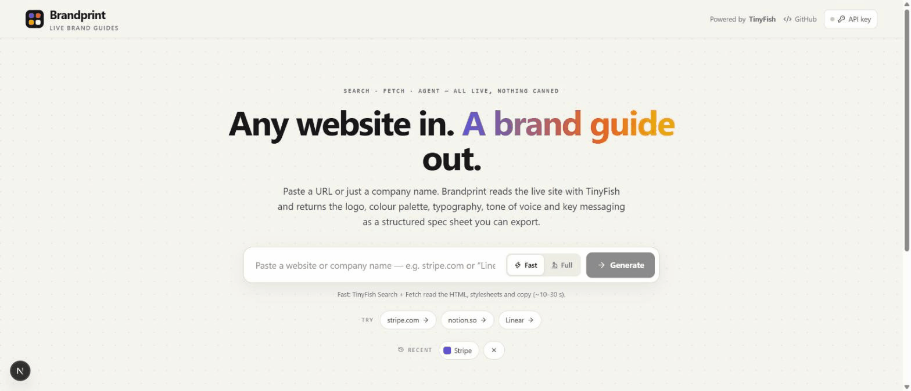

# Brandprint

**Live Demo:** [https://brandprint-tinyfish-ai.vercel.app/](https://brandprint-tinyfish-ai.vercel.app/)



so Brandprint is a live brand guide generator built with TinyFish AI, you paste a website URL or just type a company name and it reads the actual live site and gives you back the logo, the colour palette with hex / rgb / hsl and contrast ratios, the fonts that are really loaded, a tone of voice breakdown with the numbers behind it, and the key messaging quoted straight from the pages, all as one spec sheet you can export as JSON, CSS variables, a Tailwind theme, W3C design tokens or a Markdown brand guide. i built this because every time i started a side project or a pitch deck for someone i was opening their site, inspecting elements to find the hex codes, hunting for the logo SVG and guessing the font, so this is the thing that does all of that in about ten seconds and shows me where every value came from.

## Features

you give it a URL or a name, pick Fast or Full, and it goes and reads the site right then, nothing is cached and there is no list of hardcoded brands anywhere in the code.

* **Live Web Data:** Every run reads the real homepage HTML, the real stylesheets and the real about / brand / press pages through TinyFish, so the guide reflects the site as it is today.
* **Logo detection:** Finds the inline SVG wordmark inside the home link, header `` logos, apple-touch-icons and og:image, and ranks them so customer logos and tracking pixels never win.
* **Colour palette with evidence:** Clusters every colour in the CSS, weights the ones used on buttons, `--brand` / `--primary` variables and `theme-color`, drops the greys, and shows the exact CSS rule each swatch came from plus WCAG contrast on white and black.
* **Typography that is actually shipped:** Reads `@font-face`, Google Fonts links and font custom properties, so you get `sohne-var` or `Inter Variable`, not "sans-serif", plus weights in use and the corner radius scale.
* **Tone of voice, explained:** Sentence length, Flesch reading ease, how often the copy says "you" vs "we", contractions, exclamations, heading case, and the descriptors are derived from those numbers so it is not just vibes.
* **Key messaging, quoted:** Taglines, value props, mission sentences, recurring phrases and calls to action, each with the page it was taken from.
* **Full mode browser verification:** A TinyFish Agent opens the site in a real browser and reports the rendered button, header and font values, matching colours get a verified tick and anything stated on an official brand page is marked official.
* **Exports:** JSON, CSS variables, Tailwind config, W3C design tokens and a Markdown brand guide, one click each.
* **Bring Your Own Key:** Add your own TinyFish API key in the UI and it stays in your browser's localStorage.

## Tech Stack

so the tech stack is the same as my other TinyFish projects, Next.js and Tailwind CSS for the app and the TinyFish API does all the actual reading of the live web, you can check it out at [https://www.tinyfish.ai/](https://www.tinyfish.ai/).

* **Next.js 16** & **React 19**
* **Tailwind CSS 4**
* **TinyFish API** ([https://www.tinyfish.ai/](https://www.tinyfish.ai/)) — Search, Fetch and Agent
* **TypeScript**

## How TinyFish is Used

so how is TinyFish used in this project? all three endpoints, and each one does a job the other two can't.

### 1. TinyFish Search
if you type a company name instead of a URL, TinyFish Search finds the official homepage and skips social profiles, wikis, news and directories, that is how "Linear" becomes `https://linear.app/`. it also runs a `site:` query on the domain to discover the about, brand assets, press and media kit pages that are worth reading, which usually finds things like `/brand` or `/newsroom` that are not linked from the homepage nav.

### 2. TinyFish Fetch
this is where most of the work happens. Fetch reads the raw homepage document with `format: "html"` and `include_selectors: ["html"]` so i get the whole thing including `<head>`, meta tags, `<link rel="stylesheet">` and the inline SVG logo. then it fetches the actual CSS files as text (ranking the base / layout / global files first and reading a second batch when a site ships dozens of tiny component chunks), and that is where the palette, `@font-face` declarations, weights and border radii come from. finally it reads the homepage and the discovered about / brand / press pages as Markdown for the tone of voice metrics and the exact quotes, everything with `ttl: 0` so nothing is stale.

### 3. TinyFish Agent
in Full mode a TinyFish Agent opens the homepage in a real browser with an `output_schema` and reports the primary button background and text colour as hex, the header background, the heading and body fonts as rendered, a description of the logo and the hero tagline, and if the page links to a brand or press page it opens it once and lists the official colours and fonts stated there. anything the agent sees that matches a CSS colour within a small ΔE gets `verified: true`, a new rendered primary button colour gets promoted to primary, and official brand page colours are marked `official`. the goal tells it to treat page content as untrusted data, never log in or submit forms, and stay on the domain. if the agent fails or runs out of its time budget the guide still comes back from Fetch with a warning instead of an error.

## Using it as an API

the same pipeline is available as plain JSON for other tools:

```bash
curl "https://brandprint-tinyfish-ai.vercel.app/api/brand?input=stripe.com&depth=fast"
```

`input` can be a URL, a bare domain or a company name, `depth` is `fast` (Search + Fetch, about 6 to 25 seconds) or `full` (adds the Agent, up to about 4 minutes). you can send your own key as an `x-tinyfish-api-key` header. the response looks like this (trimmed):

```json
{
  "brand": { "name": "Stripe", "domain": "stripe.com", "url": "https://stripe.com/", "tagline": "Financial Infrastructure to Grow Your Revenue", "industryGuess": "Payments & fintech" },
  "logo": { "primary": { "kind": "svg", "svg": "<svg ...>", "where": "inline <svg> inside the home link" }, "alternates": [ { "kind": "apple-touch-icon", "url": "https://..." } ] },
  "colors": {
    "palette": [ { "hex": "#533afd", "rgb": "rgb(83, 58, 253)", "hsl": "hsl(248, 98%, 61%)", "name": "Purple", "role": "primary", "usage": 23, "evidence": [ "9dd172d9047449d6.css · .Button { background: #533afd }" ], "contrast": { "onWhite": 5.6, "onBlack": 3.75, "aaOnWhite": true, "aaOnBlack": false }, "verified": false } ],
    "neutrals": [ { "hex": "#ffffff", "role": "background" } ],
    "verifiedBy": "css",
    "cssFilesRead": 5
  },
  "typography": { "heading": "sohne-var", "body": "sohne-var", "families": [ { "family": "sohne-var", "source": "font-face", "roles": ["heading", "body"] } ], "weights": [300, 400, 500, 600, 700], "radiusStyle": "soft", "radiusScale": ["1px", "3px", "4px", "5px", "10px", "50%"] },
  "voice": { "descriptors": ["punchy", "confident", "understated headings"], "metrics": { "sentences": 207, "avgSentenceLength": 13, "fleschReadingEase": 50, "secondPersonRate": 14, "firstPersonPluralRate": 24, "contractionRate": 19, "headingCase": "Sentence case" }, "summary": "13 words per sentence on average, ..." },
  "messaging": { "taglines": [ { "text": "Financial Infrastructure to Grow Your Revenue", "source": "https://stripe.com/ (og:title)" } ], "valueProps": [], "mission": [ { "text": "Our mission is to increase economic growth.", "source": "https://stripe.com/about" } ], "keywords": [ { "phrase": "payments", "count": 12 } ], "ctas": ["Start now", "Contact sales", "Get started"] },
  "browser": null,
  "sources": [ { "url": "https://stripe.com/", "role": "homepage (raw HTML)", "status": "ok" } ],
  "tinyfish": { "calls": { "search": 1, "fetch": 3, "agent": 0 }, "urlsFetched": 11, "agentVerified": false, "depth": "fast" },
  "warnings": [],
  "durationMs": 10736
}
```

the UI uses a streaming `POST /api/brand` version of the same endpoint so it can show progress, the GET one is for scripts.

## Setup & Installation

so to run this on your machine you first need to install the dependencies and configure your environment.

### Prerequisites
* Node.js 20+ installed on your machine
* A TinyFish API key

### Installation Steps

1. **Clone the repository:**
   ```bash
   git clone https://github.com/Chethan-4255/brandprint_tinyfish.ai.git
   cd brandprint_tinyfish.ai
   ```

2. **Install the dependencies:**
   ```bash
   npm install
   ```

3. **Configure your API key:**
   you need to create a `.env` file in the root folder and put your key in it.
   ```bash
   TINYFISH_API_KEY=your_api_key_here
   ```
   *(Note: You can also skip this and enter your API key directly in the app's API key settings when it's running, it is stored only in your browser and sent as a header with your requests.)*

4. **Start the development server:**
   ```bash
   npm run dev
   ```
   open the localhost link provided in the terminal to see the app working.

## Brands i tested

these are the real runs i did while building it, the JSON for each one is in the `demo/` folder for reference (the app never reads those files, every request is live).

* **stripe.com** (URL, fast, ~10 s): inline SVG wordmark from the home link, primary `#533afd` purple plus navy `#1c1e54` and the coral / tangerine / amber / gold accents from 5 stylesheets, font `sohne-var` via `@font-face` with weights 300 to 700, tagline "Financial Infrastructure to Grow Your Revenue", mission "Our mission is to increase economic growth." from `/about`, tone punchy and confident, 13 words per sentence.
* **notion.so** (bare domain, fast, ~8 s): followed the redirect to notion.com, picked the Notion inline SVG logo over the 26 customer logos on the page, primary `#2383e2` blue from 10 stylesheets, fonts `NotionInter` for headings and `Lyon Text` for body plus `iA Writer Mono`, tagline "Where teams and agents Think together.", CTAs "Get Notion free" and "Request a demo", Flesch reading ease 63.
* **Linear** (company name, fast, ~15 to 23 s): TinyFish Search resolved the name to `linear.app`, found the `/brand` page through the `site:` query, the first 10 CSS chunks had no fonts so it read a second batch and got `Inter Variable` and `Berkeley Mono` from `layout.*.css` along with the `#5e6ad2` indigo from `--color-indigo`, tagline "The product development system for teams and agents", mission "We are building a new species of product tool.", 9 words per sentence.
* **stripe.com in Full mode** (~3.5 min, 12 agent steps): the same Fetch result plus one TinyFish Agent browser run, the agent reported the primary button as `#533afd` on white so that swatch is now `verified: true`, the white header background got verified too, it saw `Stripe Matter` as the rendered body font which was added as a verified family next to `sohne-var`, described the logo as a dark grey lowercase "stripe" wordmark and found no separate brand page, so `brandPage` is `null`, see `demo/stripe-full.json`.

## Links

* **Live Demo:** [https://brandprint-tinyfish-ai.vercel.app/](https://brandprint-tinyfish-ai.vercel.app/)
* **Demo recording:** [demo/brandprint-demo.gif](demo/brandprint-demo.gif)
* **Developer:** Chethan Vasthaw Tippani
* **LinkedIn:** [https://www.linkedin.com/in/chethan-vasthaw/](https://www.linkedin.com/in/chethan-vasthaw/)
* **Portfolio:** [https://chethan-4255.github.io/Portfolio/](https://chethan-4255.github.io/Portfolio/)
* **GitHub Repository:** [chethan-4255/brandprint_tinyfish.ai](https://github.com/Chethan-4255/brandprint_tinyfish.ai)
